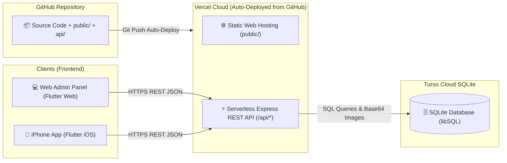

# 🚀 GitHub + Vercel + Turso (Cloud SQLite) Hosting Guideline

This guide walks you step-by-step through hosting **Festival Buddy** on **GitHub + Vercel** with **Turso (Cloud SQLite)** and connecting your **Node.js Express REST API** to both the **Web Admin Panel** and your **iPhone App**.

---

## 🏗️ Architecture Overview



### What Was Configured in Your Project:
1. **[server/index.js](file:///Users/marufahmed/Fontys%20Group%20Project/festivalbuddy/server/index.js)**:
   - Upgraded with a unified SQLite adapter (`@libsql/client` + `sqlite3` fallback).
   - When `TURSO_DATABASE_URL` and `TURSO_AUTH_TOKEN` are set in Vercel, it runs your standard SQL queries against **Turso Cloud SQLite**. When running locally on your Mac without those variables, it automatically uses your local `server/festivalbuddy.db` file.
   - Automatically creates the `festivals`, `users`, and `announcements` tables and seeds all initial festivals, organizers, and announcements on first run.
   - Converts uploaded images (`POST /api/upload`) to Base64 Data URLs (`data:image/jpeg;base64,...`) in memory so they save directly into SQLite without needing a writable local disk on Vercel.
2. **[api/index.js](file:///Users/marufahmed/Fontys%20Group%20Project/festivalbuddy/api/index.js) & [vercel.json](file:///Users/marufahmed/Fontys%20Group%20Project/festivalbuddy/vercel.json)**:
   - Routes all `/api/*` requests on Vercel to your Express REST API and serves your pre-built Flutter Web Admin Panel from `public/`.
3. **[lib/services/api_service.dart](file:///Users/marufahmed/Fontys%20Group%20Project/festivalbuddy/lib/services/api_service.dart)**:
   - On **Web**: Automatically detects if it is running on your live Vercel domain (`Uri.base.origin`) vs `http://localhost:3000`.
   - On **iPhone**: Uses `ApiService.cloudApiUrl` (or `--dart-define=API_URL=...`) so your iPhone syncs over Wi-Fi or 5G from anywhere.

---

## 📋 Step-by-Step Deployment Guide

### Step 1: Create Your Free Turso Cloud SQLite Database (2 Minutes)
Because Vercel functions are serverless (stateless), Turso hosts your persistent SQLite database in the cloud for free.

1. Go to **[https://turso.tech](https://turso.tech)** and sign in with your **GitHub** account.
2. Click **"Create Database"**:
   - **Database Name**: `festivalbuddy`
   - **Region**: Choose the closest region (e.g., `Amsterdam (ams)` or `Frankfurt (fra)`).
3. Once created, click on your `festivalbuddy` database and copy two values:
   - **Database URL**: Looks like `libsql://festivalbuddy-yourname.turso.io`
   - **Auth Token**: Click **"Generate Token"** (Read & Write) and copy the token string.

---

### Step 2: Push Your Project to GitHub
Your project is already initialized with Git. Create a new repository on GitHub and push your code:

1. Go to **[https://github.com/new](https://github.com/new)** and create a new repository named **`festivalbuddy`** (keep **"Add a README"** unchecked).
2. In your terminal inside `/Users/marufahmed/Fontys Group Project/festivalbuddy`, run:
   ```bash
   git remote add origin https://github.com/YOUR_GITHUB_USERNAME/festivalbuddy.git
   git branch -M main
   git push -u origin main
   ```

---

### Step 3: Connect GitHub to Vercel & Add Turso Variables
1. Go to **[https://vercel.com](https://vercel.com)** and sign in with **GitHub**.
2. Click **"Add New..." → "Project"** and click **"Import"** next to your `festivalbuddy` GitHub repository.
3. In the Configure Project screen:
   - **Framework Preset**: Select **Other**
   - **Output Directory**: Leave default (`public` is already configured in [vercel.json](file:///Users/marufahmed/Fontys%20Group%20Project/festivalbuddy/vercel.json))
4. Expand **"Environment Variables"** and add the two values from Step 1:
   | Key | Value |
   | :--- | :--- |
   | `TURSO_DATABASE_URL` | `libsql://festivalbuddy-yourname.turso.io` |
   | `TURSO_AUTH_TOKEN` | `eyJhbGciOiJFZERTQ...` *(your Turso token)* |
5. Click **"Deploy"**.
6. In ~15 seconds, Vercel will give you your live production URL (e.g., `https://festivalbuddy.vercel.app`).

---

### Step 4: Verify Your Hosted Web Admin & REST API
1. **Test the REST API Health & Database Connection**:
   Open `https://YOUR-VERCEL-URL.vercel.app/api/health` in your browser. You will see:
   ```json
   {
     "status": "ok",
     "mode": "turso-cloud-sqlite",
     "time": "2026-11-16T..."
   }
   ```
2. **Test the SQLite Festivals Endpoint**:
   Open `https://YOUR-VERCEL-URL.vercel.app/api/festivals` — it will automatically initialize your SQLite tables in Turso, seed the initial festivals/organizers/announcements, and return the JSON array!
3. **Open Your Live Web Admin Panel**:
   Open `https://YOUR-VERCEL-URL.vercel.app` — your Flutter Web Admin Dashboard will load and automatically communicate with `/api/*` on the same Vercel domain.

---

### Step 5: Connect Your iPhone App to the Live Vercel REST API
Once you have your `https://YOUR-VERCEL-URL.vercel.app` domain:

1. Open [lib/services/api_service.dart](file:///Users/marufahmed/Fontys%20Group%20Project/festivalbuddy/lib/services/api_service.dart#L9-L12) and replace the `defaultValue` with your Vercel URL:
   ```dart
   static const String cloudApiUrl = String.fromEnvironment(
     'API_URL',
     defaultValue: 'https://YOUR-VERCEL-URL.vercel.app',
   );
   ```
2. Deploy the release app to your iPhone:
   ```bash
   "/Users/marufahmed/Fontys Group Project/flutter/bin/flutter" run --release -d 00008140-000E21E41082201C
   ```
   Now your iPhone app will fetch and publish festivals, organizer approvals, banners, and announcements directly to your cloud SQLite database from anywhere!

---

## 🔄 How to Update the Web Admin Panel in the Future
Whenever you make changes to the Flutter UI code and want to update the hosted Web Admin Panel on Vercel:
```bash
./build_web_for_vercel.sh
git add .
git commit -m "Update web admin and API"
git push
```
Vercel will automatically detect the GitHub push and deploy your update in seconds!
