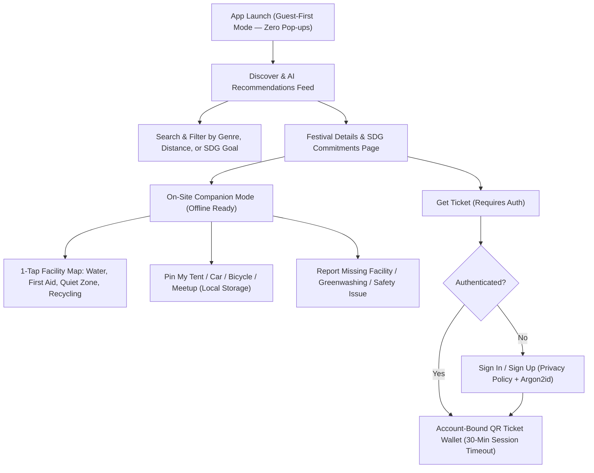

# Festival Buddy — Complete Analysis & Advice Document

**Group Members:** Burdzhu, Maruf, Yusuf, Priya, Filip  
**Project Challenge:** Festival Companion  

---

## 1. Challenge and Project Idea

The challenge asks us to create an application that improves the festival experience for visitors while remaining effortless to use—even for people with minimal technology experience.

Our concept is **Festival Buddy**, a two-sided sustainable festival discovery and on-site companion platform:

1. **Organizer Side (Two-Sided Platform):** Festival companies can publish their events and offer tickets only after signing the **Festival Buddy Environmental & Visitor Safety Responsibility Agreement**. This requires committing to core sustainability and well-being measures such as free freshwater refill points, staffed first aid and quiet zones, reusable cup systems, separated recycling bins, and transparent public transport options.
2. **Visitor Side (Pre-Event Discovery + On-Site Companion):**
   - **Pre-Event Discovery:** Visitors can browse and compare festivals in one place—seeing what kind of festival it is, when and where it takes place, how many visitors have bought tickets through the app, how to get there, public transport and festival shuttle options, and an itemized checklist of the organizer's environmental commitments linked to the **UN Sustainable Development Goals (SDGs 3, 11, 12, 13, 16, and 17)**. An **Explainable AI Recommendation Engine** suggests festivals based on music tastes, travel distance, sustainability priorities, and previously attended festivals.
   - **On-Site Companion Mode (Offline-Ready):** During the festival, visitors can use the app without needing a strong mobile connection or an account to locate free drinking water points, first aid tents, quiet rest zones, stages, and recycling points, as well as save offline pins for their **tent, parked car, bicycle, or friend meetup spot**.

> [!IMPORTANT]
> **Resolving the Onboarding vs. Security Trade-Off:**  
> Industry research shows that **42% of festival visitors abandon event apps if forced to register an account before using the app**. Festival Buddy solves this by launching in **Guest-First Mode** for browsing festivals and using offline on-site safety maps, while enforcing authentication, Argon2id password security, and 30-minute session timeouts strictly for sensitive actions (Ticket Wallet, GDPR Personal Data Center, Reporting, and Organizer/Admin portals).

---

### 1.1 Interactive Media Contribution

As the Interactive Media student, I will design the Festival Buddy mobile experience in Figma and align it with the Flutter prototype. I will design the Guest-First discovery feed, the sign-up and sign-in modal, the festival details and SDG commitment view, the saved favourites & ticket wallet view, and the offline on-site companion map.

On the festival details page, visitors can find all essential information in one place: festival genre/vibe, dates and location, live count of tickets bought through the app, travel directions, public transport and festival shuttle options, and the organizer's verified SDG commitments.

To ensure the app feels joyful yet accessible to users with minimal ICT experience, I will apply high-contrast color pairings, large touch targets, clear icon-plus-text labels, an **Easy-Read Large Text** toggle, and an **Outdoor / Night Stage High-Contrast Mode**. I will conduct usability testing with teachers and classmates using structured task scenarios and iterate on the UI based on their feedback.

---

### 1.2 Software Contribution

As the Software Engineering student, I will architect and build the cross-platform **Festival Buddy** mobile prototype for **iOS and Android using Flutter (Dart)**. My main goal is to translate our group's functional and non-functional requirements into a modular, responsive, and offline-resilient application that connects the work of Interactive Media, AI Basics, and Cybersecurity.

Specifically, my contribution includes:
1. **System Architecture & User Flow Design:** Creating the software flowcharts and state management architecture (`AppState`) that connect Guest browsing, authenticated Visitor ticket wallets, the Organizer SDG Pledge portal, and the Admin verification dashboard.
2. **Pre-Event & On-Site Hybrid Implementation:** Building the searchable/filterable Discover feed, the Festival Details & SDG breakdown view, and the **Offline On-Site Companion Mode** (interactive venue map with 1-tap filters for water, first aid, quiet zones, and toilets; local offline pin storage for a visitor's tent, car, or bike; and an offline stage schedule).
3. **Cross-Discipline Integration:**
   - Integrating the **AI Basics** content-based recommendation scoring and *"Why recommended"* explainability badges directly into the Flutter UI.
   - Implementing the **Cybersecurity** controls in code: input sanitization, simulated Argon2id salting/hashing, 5-attempt brute-force lockout, 30-minute session timeout, account-bound QR ticket isolation, and the 1-click GDPR data export/deletion center.
4. **Benchmarking & Usability Verification:** Conducting showroom benchmark tests to verify that visitors and organizers can complete core tasks (finding free water, checking SDG commitments, buying a simulated ticket, and publishing an event) quickly and without confusion.

---

### 1.3 Cyber Security Contribution 1 (Authentication, Access Control & Ticket Security)

As Cybersecurity Student 1, I will focus on the security risks related to visitor accounts, ticket fraud, unauthorized access, and session hijacking:
- Researching OWASP Mobile & Authentication guidelines to prevent weak passwords, credential stuffing, and unauthorized role escalation.
- Designing Role-Based Access Control (RBAC) separating **Guests**, **Registered Visitors**, **Organizers**, and **Administrators** using PlantUML / draw.io diagrams.
- Specifying and testing controls for **Argon2id** salted password hashing, **5-failed-attempt 15-minute account lockouts**, **single-use 24-hour password reset tokens** that invalidate active sessions, **30-minute inactivity session timeouts**, and **account-bound SHA-256 QR tickets**.

---

### 1.4 Cyber Security Contribution 2 (Privacy/GDPR, Anti-Greenwashing Integrity & Audit Logging)

As Cybersecurity Student 2, I will focus on **data privacy (GDPR compliance), information reliability (preventing misleading organizer eco-claims / "greenwashing"), input validation, and security monitoring/audit logging**:
1. **GDPR & Privacy-by-Design:** Ensuring **Data Minimization** so Festival Buddy collects only strictly necessary personal data (email, display name, ticket IDs, and optional preference tags, while keeping on-site tent/car pins local to the device). I will design the **Privacy & GDPR Center** accessible within **≤3 clicks from the Profile screen**, allowing users to view their stored data, export a machine-readable JSON copy, and request account erasure.
2. **Information Reliability & Anti-Greenwashing Governance:** Investigating how platforms prevent fraudulent or exaggerated sustainability claims. In Festival Buddy, organizers must sign an itemized SDG Responsibility Pledge, visitors can submit on-site verification reports (*"Misleading Eco-Claim"*, *"Empty Water Station"*, or *"Unsafe Situation"*), and Administrators can review, flag, or remove non-compliant listings.
3. **Input Validation, Backup Policy & Security Audit Logging:** Defining input sanitization rules against injection attacks across search, profile, and organizer forms, establishing a 30-day encrypted daily backup and monthly restoration policy, and designing an **Immutable Security Audit Log** that records failed logins, lockouts, password resets, role changes, festival edits, and GDPR deletion requests.

---

### 1.5 AI Basics Contribution

As the AI Basics student, I will design and test a **Content-Based Festival Recommendation & SDG Eco-Scoring System**:
- Using Python, Pandas, and Scikit-learn (`cosine_similarity`) in Google Colab (`ai_recommendation/festival_recommender.py`) to compare user feature vectors (preferred music genres, maximum travel distance, SDG priorities, and previously attended festivals) against festival feature vectors.
- Implementing **Explainable AI** so every recommendation clearly states *why* it matches the visitor (e.g., *"94% Match — Matches Electronic & Indie, 100% reusable cups (SDG 12), and within 4 km"*).
- Designing a transparent, itemized **9-point SDG Eco-Commitment Score** rather than a vague eco-label, avoiding misleading greenwashing claims.

---

## 2. Scope & MoSCoW Prioritization Table

| Priority | Feature / Requirement | Study Area(s) | Included in Prototype? |
| :--- | :--- | :--- | :--- |
| **Must Have** | **Guest-First Festival Discovery Feed** (Search, Genre & SDG filters, zero pop-up onboarding) | Interactive Media, Software | ✅ Yes (`main_shell.dart`) |
| **Must Have** | **Festival Details & SDG Commitment Checklist** (Dates, ticket counter, transit info, 9-point SDG checklist) | Interactive Media, Software | ✅ Yes (`festival_detail_screen.dart`) |
| **Must Have** | **Explainable AI Recommendation Engine** (Match % ranking + *"Why recommended"* explanation + Python script) | AI Basics, Software | ✅ Yes (`app_state.dart` & `festival_recommender.py`) |
| **Must Have** | **Offline On-Site Companion Map** (1-tap filters for Free Water, First Aid, Quiet Zones, Toilets, Recycling, Stages) | Interactive Media, Software | ✅ Yes (`companion_view.dart`) |
| **Must Have** | **Authentication, Argon2id Hashing & 5-Attempt Lockout** (15-min lockout + 30-min inactivity logout + 24h single-use reset) | Cybersecurity 1, Software | ✅ Yes (`auth_modal.dart` & `app_state.dart`) |
| **Must Have** | **GDPR Privacy Center in ≤3 Clicks** (Privacy policy before sign-up, View, JSON Export & Account Deletion request) | Cybersecurity 2, Interactive Media | ✅ Yes (`profile_security_screen.dart`) |
| **Should Have** | **Offline "Pin My Tent / Car / Bicycle / Meetup" Tool** | Software, Interactive Media | ✅ Yes (`companion_view.dart`) |
| **Should Have** | **Two-Sided Organizer SDG Pledge & Admin Approval Portal** (RBAC enforced) | Software, Cybersecurity 1 & 2 | ✅ Yes (`organizer_admin_screen.dart`) |
| **Should Have** | **Anti-Greenwashing & Safety Reporting + Security Audit Log** | Cybersecurity 2, AI Basics | ✅ Yes (`companion_view.dart` & `profile_security_screen.dart`) |
| **Could Have** | **High-Contrast Outdoor/Night Mode & Easy-Read Large Text Toggles** | Interactive Media, Software | ✅ Yes (`main.dart` & `profile_security_screen.dart`) |
| **Could Have** | **Simulated Account-Bound QR Ticket Checkout** | Software, Cybersecurity 1 | ✅ Yes (`festival_detail_screen.dart`) |
| **Won't Have (Now)** | **Real Payment Gateway (iDEAL / Stripe) & Legal Company Contracts** | Business / Out of Scope | ❌ Simulated only |
| **Won't Have (Now)** | **Live Peer-to-Peer Bluetooth Mesh Friend Tracking & Penetration Testing** | Out of Scope | ❌ Excluded from prototype |
